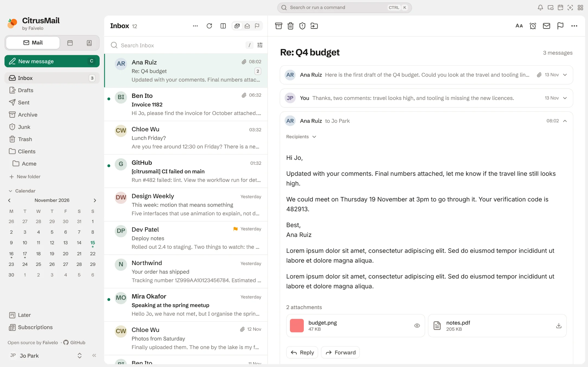
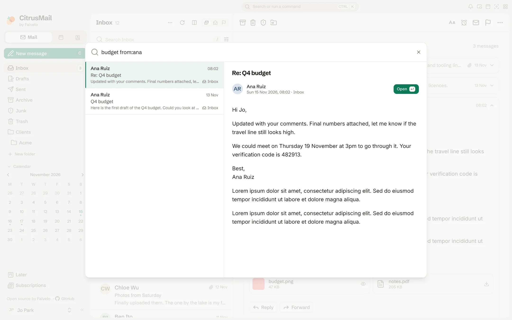
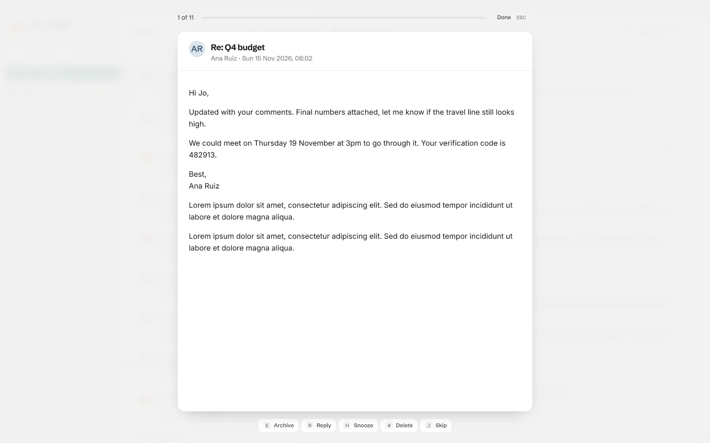
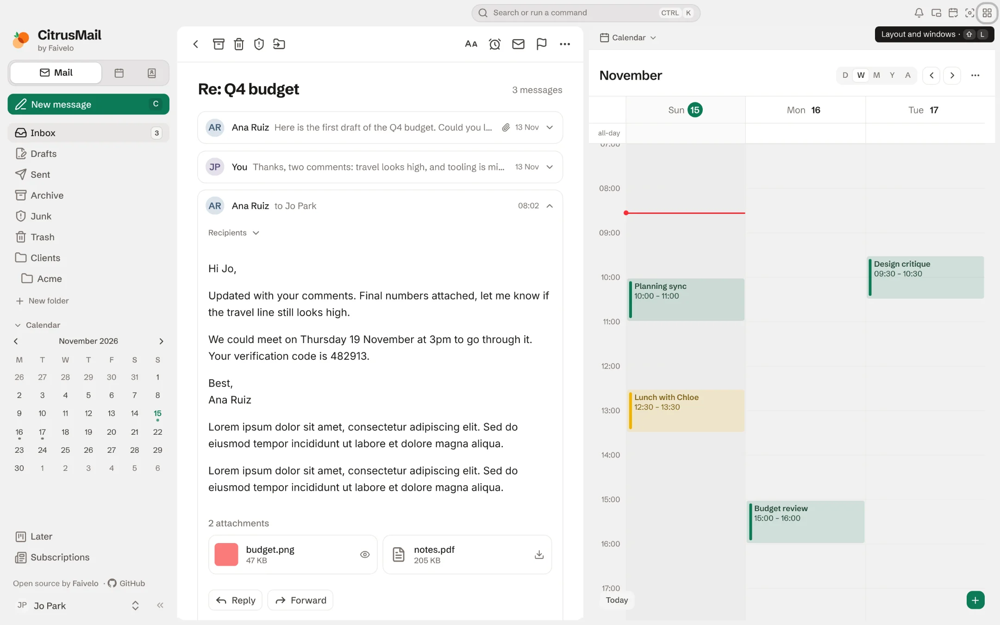
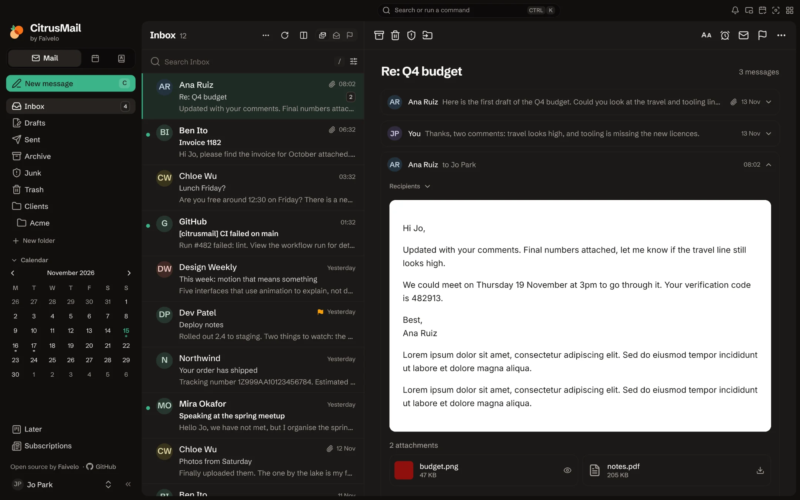
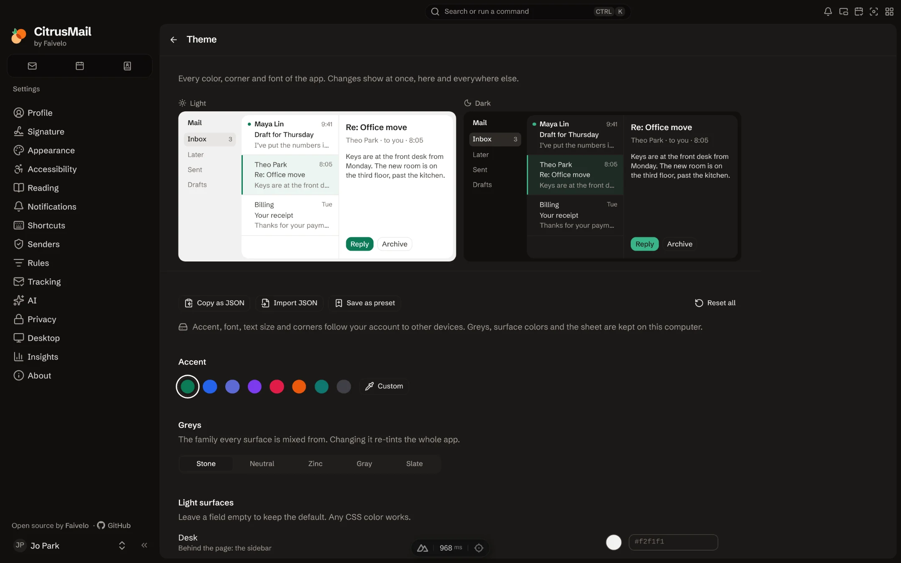
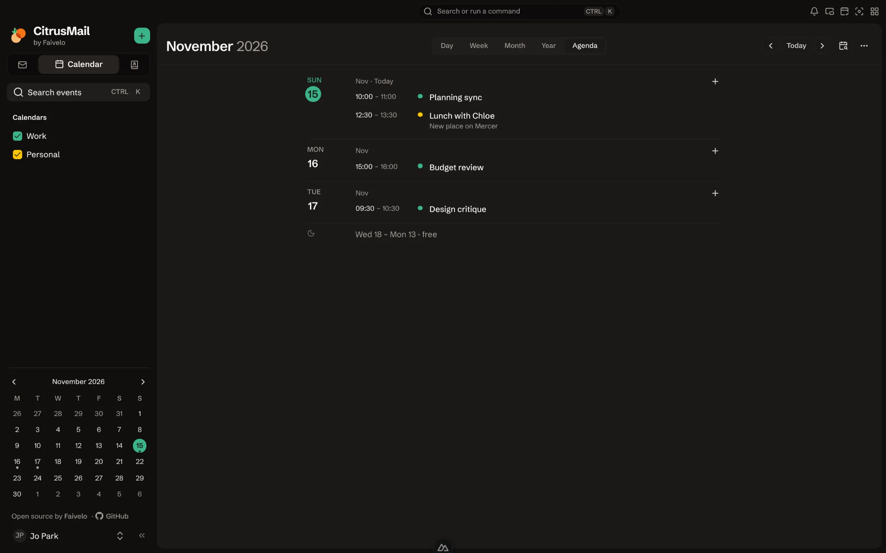

# A tour of CitrusMail

The pictures are of the app with made-up mail in it. Everything shown works in the browser and in the desktop app, except split layouts, which are a desktop feature.

## Reading

Replies are grouped into one conversation. Older messages fold to a line each and the newest is open; your own replies are pulled in from Sent. Under the sender, chips pick out what you might act on: a date to put on the calendar, a tracking number, a code to copy. Reply without leaving the message from the box at the bottom.

The list keeps up with you: pinned mail first, snoozed mail out of the way until it's due, labels beside each subject, and a dot for what you haven't read. Tick rows (hover the avatar, or press `x`) to archive, move, label or snooze several at once. Archive and delete can be undone for five seconds.

## Search every folder

`Ctrl/⌘Shift+F` searches every folder at once. Narrow it with `from:`, `has:attachment`, `is:unread`, `before:` and `after:` dates, `in:` a folder or `label:`. Results fill in folder by folder, and the highlighted one is shown beside the list without being marked read.

## Triage

`Shift+T` takes the Inbox one message at a time. Each key decides one and brings the next: `e` to archive, `r` to reply, `h` to snooze until tomorrow, `#` to delete, `j` to skip.

## Split layouts and more windows

In the desktop app, the layout button at the top right splits the window into two, three or four panes, each with a page of its own. Any page can also open in a window of its own (`Shift+O`) and be moved to another screen. Save an arrangement of windows as a workspace to get it back in one click.

## Dark, and the rest of the looks

Light, dark, or following the system or the time of day. Sixteen ready-made looks, a separate accent for each mailbox, and for anything else the theme editor:

It shows a small copy of the app in light and dark as you change it, gives the contrast of every text colour against its background, and copies the result as JSON for `app.config.ts` (see [THEMING.md](../THEMING.md)).

## Calendar

Day, week, month, year and agenda. Add a second time zone and every time is shown in both. **Find a time** lets you mark free slots on the grid and writes them into a message for you. A small month with busy days dotted sits in the mail sidebar, and `Shift+D` opens today's agenda from anywhere.

## Writing

Open several drafts at once: they sit as tabs along the bottom while you read. `Ctrl/⌘Shift+D` gives one the whole window. Type `/` for commands, `:` for emoji, and Markdown as you go; add tables, pictures you can resize, and code blocks coloured by language. Choose between several signatures, see the time where your recipient is, and schedule for their morning. Undo send holds a message for the seconds you choose.

## And

- **Later**: a board of mail you've set aside, in To do, Waiting and Done.
- **Notifications**: the bell keeps what the app told you, from new mail to a message that couldn't be sent.
- **Contacts**: groups you can write to in one go, photos and time zones, import and export, and a view of who you're in touch with and who's waiting on you.
- **Accessibility**: the whole app by keyboard and screen reader, with high contrast, larger text and reduced motion in Settings → Accessibility.
